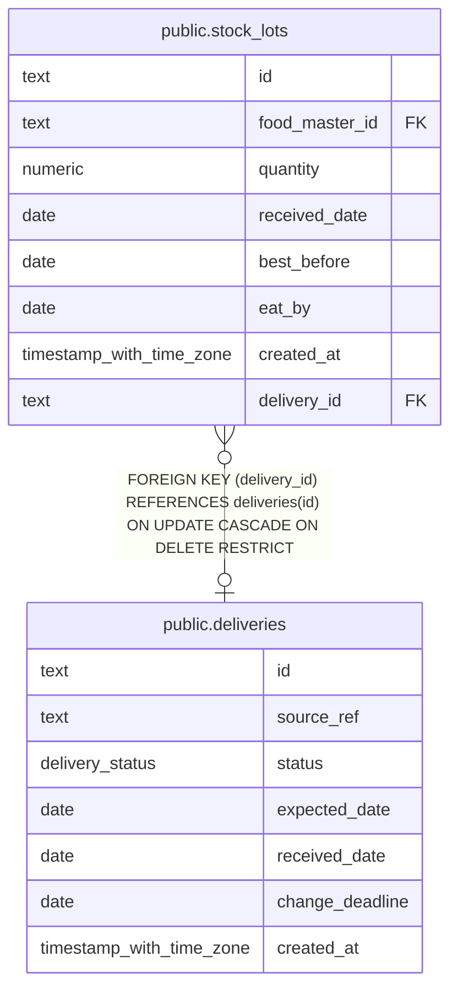

# public.deliveries

## Description

Expected deliveries and receipt status for stock inventory.

## Columns

| Name            | Type                     | Default                    | Nullable | Children                                  | Parents | Comment                                                       |
| --------------- | ------------------------ | -------------------------- | -------- | ----------------------------------------- | ------- | ------------------------------------------------------------- |
| id              | text                     |                            | false    | [public.stock_lots](public.stock_lots.md) |         |                                                               |
| source_ref      | text                     |                            | true     |                                           |         | External identifier used to deduplicate delivery updates.     |
| status          | delivery_status          | 'planned'::delivery_status | false    |                                           |         | Lifecycle state of the delivery.                              |
| expected_date   | date                     |                            | false    |                                           |         | Date the delivery is expected to arrive.                      |
| received_date   | date                     |                            | true     |                                           |         | Date the delivery was received.                               |
| change_deadline | date                     |                            | true     |                                           |         | Deadline for changing or cancelling the delivery, when known. |
| created_at      | timestamp with time zone | now()                      | false    |                                           |         |                                                               |

## Constraints

| Name                                    | Type        | Definition                                                                     |
| --------------------------------------- | ----------- | ------------------------------------------------------------------------------ |
| deliveries_created_at_not_null          | n           | NOT NULL created_at                                                            |
| deliveries_expected_date_not_null       | n           | NOT NULL expected_date                                                         |
| deliveries_id_not_null                  | n           | NOT NULL id                                                                    |
| deliveries_received_date_matches_status | CHECK       | CHECK (((status = 'received'::delivery_status) = (received_date IS NOT NULL))) |
| deliveries_source_ref_nonblank          | CHECK       | CHECK (((source_ref IS NULL) OR (btrim(source_ref) <> ''::text)))              |
| deliveries_status_not_null              | n           | NOT NULL status                                                                |
| deliveries_pkey                         | PRIMARY KEY | PRIMARY KEY (id)                                                               |

## Indexes

| Name                                | Definition                                                                                                |
| ----------------------------------- | --------------------------------------------------------------------------------------------------------- |
| deliveries_pkey                     | CREATE UNIQUE INDEX deliveries_pkey ON public.deliveries USING btree (id)                                 |
| deliveries_source_ref_key           | CREATE UNIQUE INDEX deliveries_source_ref_key ON public.deliveries USING btree (source_ref)               |
| deliveries_status_expected_date_idx | CREATE INDEX deliveries_status_expected_date_idx ON public.deliveries USING btree (status, expected_date) |

## Relations

---

> Generated by [tbls](https://github.com/k1LoW/tbls)
