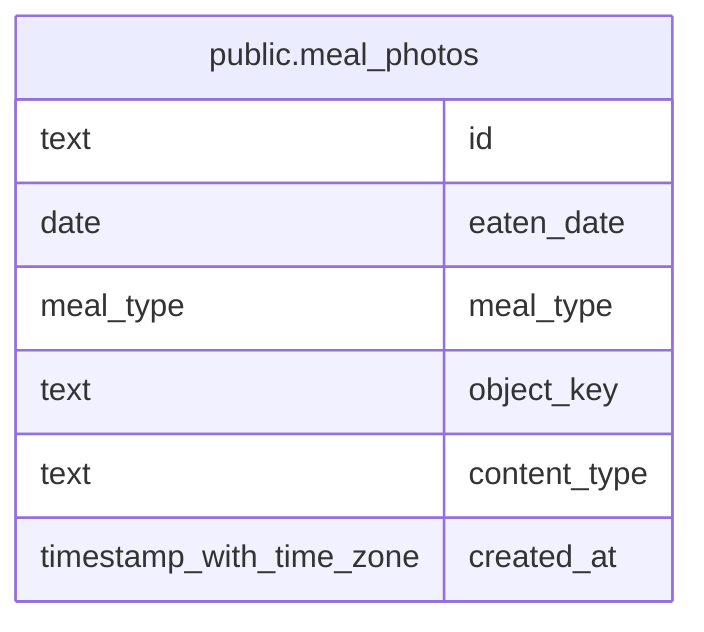

# public.meal_photos

## Description

Photos attached to a meal on a specific date.

## Columns

| Name         | Type                     | Default | Nullable | Children | Parents | Comment                               |
| ------------ | ------------------------ | ------- | -------- | -------- | ------- | ------------------------------------- |
| id           | text                     |         | false    |          |         |                                       |
| eaten_date   | date                     |         | false    |          |         | Asia/Tokyo calendar date of the meal. |
| meal_type    | meal_type                |         | false    |          |         | Meal category the photos belong to.   |
| object_key   | text                     |         | false    |          |         | Unique key of the photo object in R2. |
| content_type | text                     |         | false    |          |         | Image media type: JPEG, PNG, or WebP. |
| created_at   | timestamp with time zone | now()   | false    |          |         |                                       |

## Constraints

| Name                              | Type        | Definition                                                                                      |
| --------------------------------- | ----------- | ----------------------------------------------------------------------------------------------- |
| meal_photos_content_type_check    | CHECK       | CHECK ((content_type = ANY (ARRAY['image/jpeg'::text, 'image/png'::text, 'image/webp'::text]))) |
| meal_photos_content_type_not_null | n           | NOT NULL content_type                                                                           |
| meal_photos_created_at_not_null   | n           | NOT NULL created_at                                                                             |
| meal_photos_eaten_date_not_null   | n           | NOT NULL eaten_date                                                                             |
| meal_photos_id_not_null           | n           | NOT NULL id                                                                                     |
| meal_photos_meal_type_not_null    | n           | NOT NULL meal_type                                                                              |
| meal_photos_object_key_not_null   | n           | NOT NULL object_key                                                                             |
| meal_photos_pkey                  | PRIMARY KEY | PRIMARY KEY (id)                                                                                |

## Indexes

| Name                                 | Definition                                                                                                  |
| ------------------------------------ | ----------------------------------------------------------------------------------------------------------- |
| meal_photos_pkey                     | CREATE UNIQUE INDEX meal_photos_pkey ON public.meal_photos USING btree (id)                                 |
| meal_photos_object_key_key           | CREATE UNIQUE INDEX meal_photos_object_key_key ON public.meal_photos USING btree (object_key)               |
| meal_photos_eaten_date_meal_type_idx | CREATE INDEX meal_photos_eaten_date_meal_type_idx ON public.meal_photos USING btree (eaten_date, meal_type) |

## Relations

---

> Generated by [tbls](https://github.com/k1LoW/tbls)
