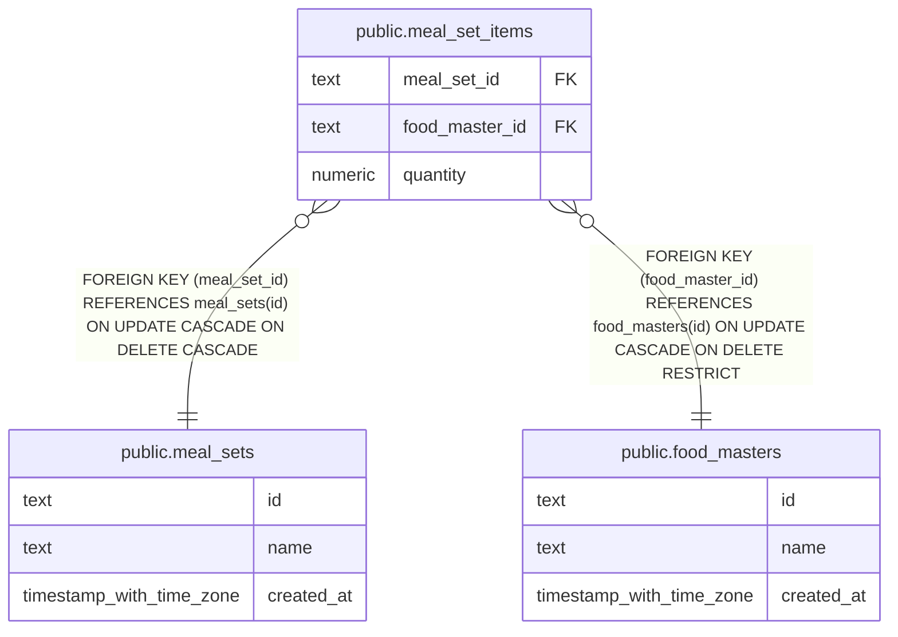

# public.meal_set_items

## Description

Foods and quantities included in a meal set.

## Columns

| Name           | Type    | Default | Nullable | Children | Parents                                       | Comment                                                  |
| -------------- | ------- | ------- | -------- | -------- | --------------------------------------------- | -------------------------------------------------------- |
| meal_set_id    | text    |         | false    |          | [public.meal_sets](public.meal_sets.md)       | Identifier of the meal set containing this food.         |
| food_master_id | text    |         | false    |          | [public.food_masters](public.food_masters.md) | Identifier of a food included in the meal set.           |
| quantity       | numeric |         | false    |          |                                               | Multiplier applied to the food master's nutrient values. |

## Constraints

| Name                                   | Type        | Definition                                                                                    |
| -------------------------------------- | ----------- | --------------------------------------------------------------------------------------------- |
| meal_set_items_food_master_id_not_null | n           | NOT NULL food_master_id                                                                       |
| meal_set_items_meal_set_id_not_null    | n           | NOT NULL meal_set_id                                                                          |
| meal_set_items_quantity_not_null       | n           | NOT NULL quantity                                                                             |
| meal_set_items_quantity_positive       | CHECK       | CHECK ((quantity > (0)::numeric))                                                             |
| meal_set_items_food_master_id_fk       | FOREIGN KEY | FOREIGN KEY (food_master_id) REFERENCES food_masters(id) ON UPDATE CASCADE ON DELETE RESTRICT |
| meal_set_items_pkey                    | PRIMARY KEY | PRIMARY KEY (meal_set_id, food_master_id)                                                     |
| meal_set_items_meal_set_id_fk          | FOREIGN KEY | FOREIGN KEY (meal_set_id) REFERENCES meal_sets(id) ON UPDATE CASCADE ON DELETE CASCADE        |

## Indexes

| Name                              | Definition                                                                                                 |
| --------------------------------- | ---------------------------------------------------------------------------------------------------------- |
| meal_set_items_pkey               | CREATE UNIQUE INDEX meal_set_items_pkey ON public.meal_set_items USING btree (meal_set_id, food_master_id) |
| meal_set_items_food_master_id_idx | CREATE INDEX meal_set_items_food_master_id_idx ON public.meal_set_items USING btree (food_master_id)       |

## Relations

---

> Generated by [tbls](https://github.com/k1LoW/tbls)
