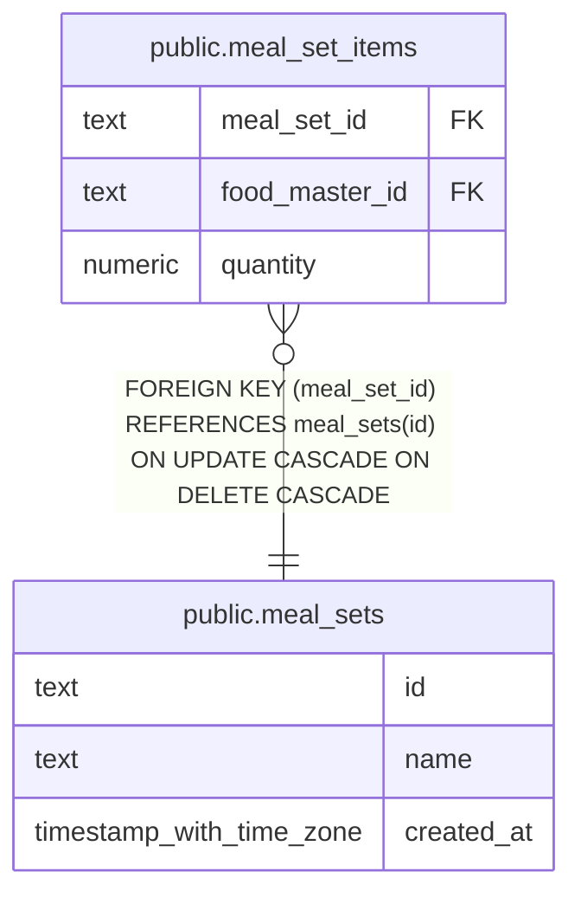

# public.meal_sets

## Description

Named groups of foods saved for repeated meal logging.

## Columns

| Name       | Type                     | Default | Nullable | Children                                          | Parents | Comment               |
| ---------- | ------------------------ | ------- | -------- | ------------------------------------------------- | ------- | --------------------- |
| id         | text                     |         | false    | [public.meal_set_items](public.meal_set_items.md) |         |                       |
| name       | text                     |         | false    |                                                   |         | Name of the meal set. |
| created_at | timestamp with time zone | now()   | false    |                                                   |         |                       |

## Constraints

| Name                          | Type        | Definition                        |
| ----------------------------- | ----------- | --------------------------------- |
| meal_sets_created_at_not_null | n           | NOT NULL created_at               |
| meal_sets_id_not_null         | n           | NOT NULL id                       |
| meal_sets_name_nonblank       | CHECK       | CHECK ((btrim(name) <> ''::text)) |
| meal_sets_name_not_null       | n           | NOT NULL name                     |
| meal_sets_pkey                | PRIMARY KEY | PRIMARY KEY (id)                  |

## Indexes

| Name                    | Definition                                                                             |
| ----------------------- | -------------------------------------------------------------------------------------- |
| meal_sets_pkey          | CREATE UNIQUE INDEX meal_sets_pkey ON public.meal_sets USING btree (id)                |
| meal_sets_name_key      | CREATE UNIQUE INDEX meal_sets_name_key ON public.meal_sets USING btree (name)          |
| meal_sets_name_trgm_idx | CREATE INDEX meal_sets_name_trgm_idx ON public.meal_sets USING gin (name gin_trgm_ops) |

## Relations

---

> Generated by [tbls](https://github.com/k1LoW/tbls)
