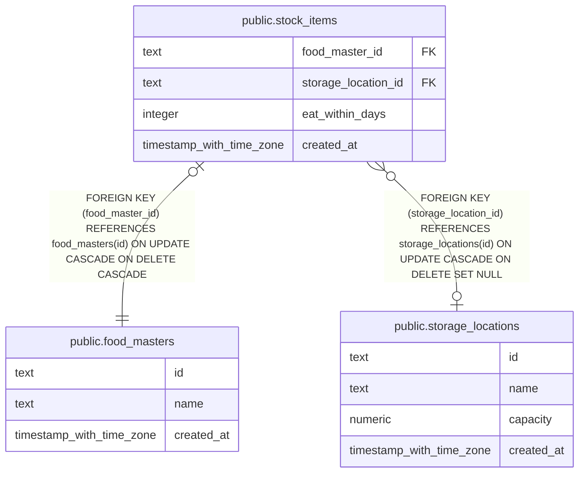

# public.stock_items

## Description

Foods configured for stock tracking.

## Columns

| Name                | Type                     | Default | Nullable | Children | Parents                                                 | Comment                                                 |
| ------------------- | ------------------------ | ------- | -------- | -------- | ------------------------------------------------------- | ------------------------------------------------------- |
| food_master_id      | text                     |         | false    |          | [public.food_masters](public.food_masters.md)           | Identifier of the food tracked in stock.                |
| storage_location_id | text                     |         | true     |          | [public.storage_locations](public.storage_locations.md) | Identifier of the optional storage location.            |
| eat_within_days     | integer                  |         | true     |          |                                                         | Target number of days from receipt to consume the food. |
| created_at          | timestamp with time zone | now()   | false    |          |                                                         |                                                         |

## Constraints

| Name                                 | Type        | Definition                                                                                              |
| ------------------------------------ | ----------- | ------------------------------------------------------------------------------------------------------- |
| stock_items_created_at_not_null      | n           | NOT NULL created_at                                                                                     |
| stock_items_eat_within_days_positive | CHECK       | CHECK (((eat_within_days IS NULL) OR (eat_within_days > 0)))                                            |
| stock_items_food_master_id_not_null  | n           | NOT NULL food_master_id                                                                                 |
| stock_items_food_master_id_fk        | FOREIGN KEY | FOREIGN KEY (food_master_id) REFERENCES food_masters(id) ON UPDATE CASCADE ON DELETE CASCADE            |
| stock_items_pkey                     | PRIMARY KEY | PRIMARY KEY (food_master_id)                                                                            |
| stock_items_storage_location_id_fk   | FOREIGN KEY | FOREIGN KEY (storage_location_id) REFERENCES storage_locations(id) ON UPDATE CASCADE ON DELETE SET NULL |

## Indexes

| Name                                | Definition                                                                                               |
| ----------------------------------- | -------------------------------------------------------------------------------------------------------- |
| stock_items_pkey                    | CREATE UNIQUE INDEX stock_items_pkey ON public.stock_items USING btree (food_master_id)                  |
| stock_items_storage_location_id_idx | CREATE INDEX stock_items_storage_location_id_idx ON public.stock_items USING btree (storage_location_id) |

## Relations

---

> Generated by [tbls](https://github.com/k1LoW/tbls)
