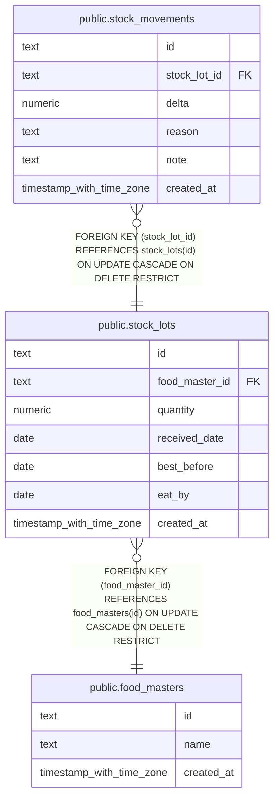

# public.stock_lots

## Description

Received or counted batches of stock for a food.

## Columns

| Name           | Type                     | Default | Nullable | Children                                            | Parents                                       | Comment                                                    |
| -------------- | ------------------------ | ------- | -------- | --------------------------------------------------- | --------------------------------------------- | ---------------------------------------------------------- |
| id             | text                     |         | false    | [public.stock_movements](public.stock_movements.md) |                                               |                                                            |
| food_master_id | text                     |         | false    |                                                     | [public.food_masters](public.food_masters.md) | Identifier of the food this batch belongs to.              |
| quantity       | numeric                  |         | false    |                                                     |                                               | Quantity originally recorded for this batch in food units. |
| received_date  | date                     |         | true     |                                                     |                                               | Date the batch was received, when known.                   |
| best_before    | date                     |         | true     |                                                     |                                               | Best-before date shown for the batch, when known.          |
| eat_by         | date                     |         | true     |                                                     |                                               | Target date to consume the batch, when known.              |
| created_at     | timestamp with time zone | now()   | false    |                                                     |                                               |                                                            |

## Constraints

| Name                               | Type        | Definition                                                                                    |
| ---------------------------------- | ----------- | --------------------------------------------------------------------------------------------- |
| stock_lots_created_at_not_null     | n           | NOT NULL created_at                                                                           |
| stock_lots_food_master_id_not_null | n           | NOT NULL food_master_id                                                                       |
| stock_lots_id_not_null             | n           | NOT NULL id                                                                                   |
| stock_lots_quantity_not_null       | n           | NOT NULL quantity                                                                             |
| stock_lots_quantity_positive       | CHECK       | CHECK ((quantity > (0)::numeric))                                                             |
| stock_lots_food_master_id_fk       | FOREIGN KEY | FOREIGN KEY (food_master_id) REFERENCES food_masters(id) ON UPDATE CASCADE ON DELETE RESTRICT |
| stock_lots_pkey                    | PRIMARY KEY | PRIMARY KEY (id)                                                                              |

## Indexes

| Name                                        | Definition                                                                                                                |
| ------------------------------------------- | ------------------------------------------------------------------------------------------------------------------------- |
| stock_lots_pkey                             | CREATE UNIQUE INDEX stock_lots_pkey ON public.stock_lots USING btree (id)                                                 |
| stock_lots_food_master_id_received_date_idx | CREATE INDEX stock_lots_food_master_id_received_date_idx ON public.stock_lots USING btree (food_master_id, received_date) |

## Relations

---

> Generated by [tbls](https://github.com/k1LoW/tbls)
