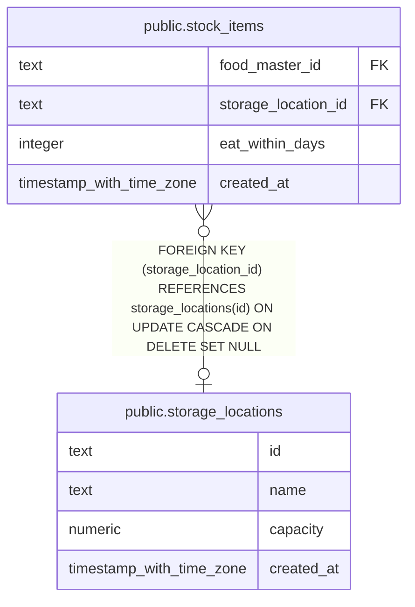

# public.storage_locations

## Description

Named places where stock items are stored.

## Columns

| Name       | Type                     | Default | Nullable | Children                                    | Parents | Comment                                        |
| ---------- | ------------------------ | ------- | -------- | ------------------------------------------- | ------- | ---------------------------------------------- |
| id         | text                     |         | false    | [public.stock_items](public.stock_items.md) |         |                                                |
| name       | text                     |         | false    |                                             |         | Unique name of the storage location.           |
| capacity   | numeric                  |         | true     |                                             |         | Optional maximum stock capacity in food units. |
| created_at | timestamp with time zone | now()   | false    |                                             |         |                                                |

## Constraints

| Name                                  | Type        | Definition                                                |
| ------------------------------------- | ----------- | --------------------------------------------------------- |
| storage_locations_capacity_positive   | CHECK       | CHECK (((capacity IS NULL) OR (capacity > (0)::numeric))) |
| storage_locations_created_at_not_null | n           | NOT NULL created_at                                       |
| storage_locations_id_not_null         | n           | NOT NULL id                                               |
| storage_locations_name_not_null       | n           | NOT NULL name                                             |
| storage_locations_pkey                | PRIMARY KEY | PRIMARY KEY (id)                                          |

## Indexes

| Name                       | Definition                                                                                    |
| -------------------------- | --------------------------------------------------------------------------------------------- |
| storage_locations_pkey     | CREATE UNIQUE INDEX storage_locations_pkey ON public.storage_locations USING btree (id)       |
| storage_locations_name_key | CREATE UNIQUE INDEX storage_locations_name_key ON public.storage_locations USING btree (name) |

## Relations

---

> Generated by [tbls](https://github.com/k1LoW/tbls)
