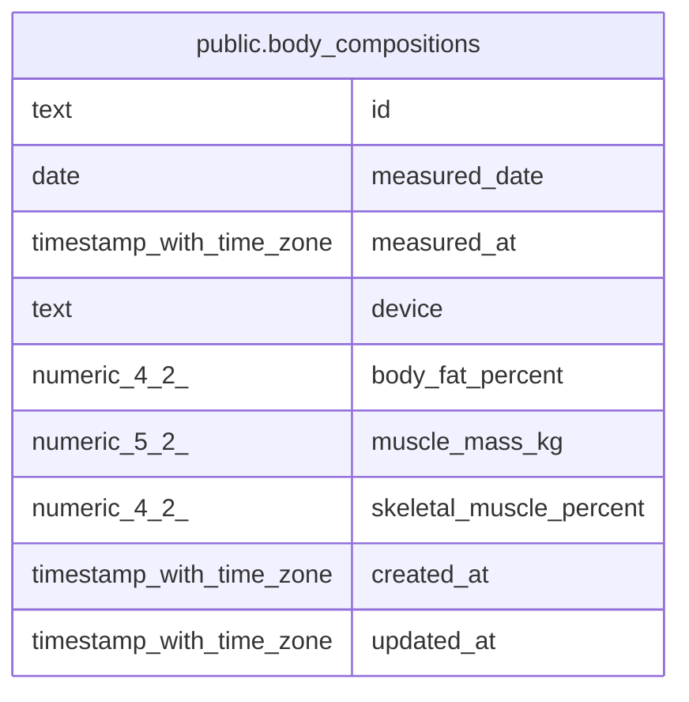

# public.body_compositions

## Description

Measured body composition records.

## Columns

| Name                    | Type                     | Default | Nullable | Children | Parents | Comment                                                                            |
| ----------------------- | ------------------------ | ------- | -------- | -------- | ------- | ---------------------------------------------------------------------------------- |
| id                      | text                     |         | false    |          |         |                                                                                    |
| measured_date           | date                     |         | false    |          |         | Asia/Tokyo calendar date when the body composition was measured.                   |
| measured_at             | timestamp with time zone |         | true     |          |         | Measurement instant, when known.                                                   |
| device                  | text                     |         | false    |          |         | Device used to measure body composition.                                           |
| body_fat_percent        | numeric(4,2)             |         | true     |          |         | Estimated body fat percentage; the API accepts values from 1 to 75 percent.        |
| muscle_mass_kg          | numeric(5,2)             |         | true     |          |         | Estimated muscle mass in kilograms; the API accepts values from 5 to 200 kg.       |
| skeletal_muscle_percent | numeric(4,2)             |         | true     |          |         | Estimated skeletal muscle percentage; the API accepts values from 1 to 75 percent. |
| created_at              | timestamp with time zone | now()   | false    |          |         |                                                                                    |
| updated_at              | timestamp with time zone | now()   | false    |          |         |                                                                                    |

## Constraints

| Name                                            | Type        | Definition                                                                                                                                |
| ----------------------------------------------- | ----------- | ----------------------------------------------------------------------------------------------------------------------------------------- |
| body_compositions_body_fat_percent_range        | CHECK       | CHECK (((body_fat_percent IS NULL) OR ((body_fat_percent >= (1)::numeric) AND (body_fat_percent <= (75)::numeric))))                      |
| body_compositions_created_at_not_null           | n           | NOT NULL created_at                                                                                                                       |
| body_compositions_device_not_null               | n           | NOT NULL device                                                                                                                           |
| body_compositions_has_value                     | CHECK       | CHECK ((num_nonnulls(body_fat_percent, muscle_mass_kg, skeletal_muscle_percent) >= 1))                                                    |
| body_compositions_id_not_null                   | n           | NOT NULL id                                                                                                                               |
| body_compositions_measured_date_not_null        | n           | NOT NULL measured_date                                                                                                                    |
| body_compositions_muscle_mass_kg_range          | CHECK       | CHECK (((muscle_mass_kg IS NULL) OR ((muscle_mass_kg >= (5)::numeric) AND (muscle_mass_kg <= (200)::numeric))))                           |
| body_compositions_skeletal_muscle_percent_range | CHECK       | CHECK (((skeletal_muscle_percent IS NULL) OR ((skeletal_muscle_percent >= (1)::numeric) AND (skeletal_muscle_percent <= (75)::numeric)))) |
| body_compositions_updated_at_not_null           | n           | NOT NULL updated_at                                                                                                                       |
| body_compositions_pkey                          | PRIMARY KEY | PRIMARY KEY (id)                                                                                                                          |
| body_compositions_measurement_key               | UNIQUE      | UNIQUE NULLS NOT DISTINCT (measured_date, measured_at, device, body_fat_percent, muscle_mass_kg, skeletal_muscle_percent)                 |

## Indexes

| Name                              | Definition                                                                                                                                                                                                       |
| --------------------------------- | ---------------------------------------------------------------------------------------------------------------------------------------------------------------------------------------------------------------- |
| body_compositions_pkey            | CREATE UNIQUE INDEX body_compositions_pkey ON public.body_compositions USING btree (id)                                                                                                                          |
| body_compositions_measurement_key | CREATE UNIQUE INDEX body_compositions_measurement_key ON public.body_compositions USING btree (measured_date, measured_at, device, body_fat_percent, muscle_mass_kg, skeletal_muscle_percent) NULLS NOT DISTINCT |

## Relations

---

> Generated by [tbls](https://github.com/k1LoW/tbls)
