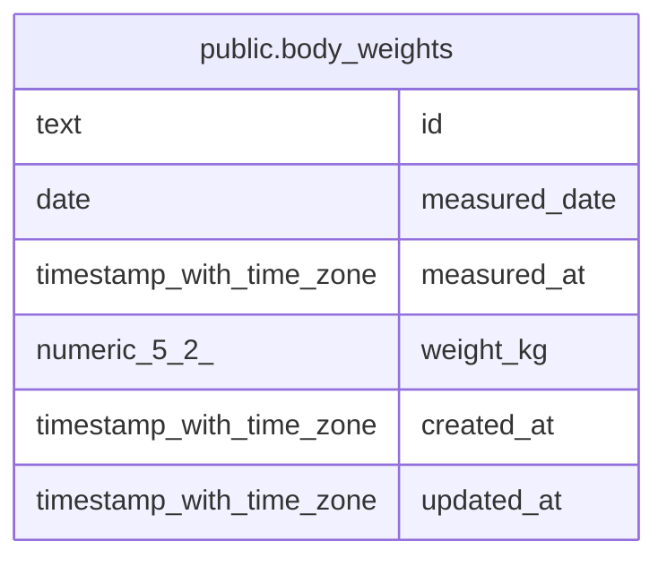

# public.body_weights

## Description

Measured body weight records.

## Columns

| Name          | Type                     | Default | Nullable | Children | Parents | Comment                                                |
| ------------- | ------------------------ | ------- | -------- | -------- | ------- | ------------------------------------------------------ |
| id            | text                     |         | false    |          |         |                                                        |
| measured_date | date                     |         | false    |          |         | Asia/Tokyo calendar date when the weight was measured. |
| measured_at   | timestamp with time zone |         | true     |          |         | Measurement instant, when known.                       |
| weight_kg     | numeric(5,2)             |         | false    |          |         | Measured body weight in kilograms.                     |
| created_at    | timestamp with time zone | now()   | false    |          |         |                                                        |
| updated_at    | timestamp with time zone | now()   | false    |          |         |                                                        |

## Constraints

| Name                                                 | Type        | Definition                                                        |
| ---------------------------------------------------- | ----------- | ----------------------------------------------------------------- |
| body_weights_created_at_not_null                     | n           | NOT NULL created_at                                               |
| body_weights_id_not_null                             | n           | NOT NULL id                                                       |
| body_weights_measured_date_not_null                  | n           | NOT NULL measured_date                                            |
| body_weights_updated_at_not_null                     | n           | NOT NULL updated_at                                               |
| body_weights_weight_kg_not_null                      | n           | NOT NULL weight_kg                                                |
| body_weights_weight_kg_positive                      | CHECK       | CHECK ((weight_kg > (0)::numeric))                                |
| body_weights_pkey                                    | PRIMARY KEY | PRIMARY KEY (id)                                                  |
| body_weights_measured_date_measured_at_weight_kg_key | UNIQUE      | UNIQUE NULLS NOT DISTINCT (measured_date, measured_at, weight_kg) |

## Indexes

| Name                                                 | Definition                                                                                                                                                             |
| ---------------------------------------------------- | ---------------------------------------------------------------------------------------------------------------------------------------------------------------------- |
| body_weights_pkey                                    | CREATE UNIQUE INDEX body_weights_pkey ON public.body_weights USING btree (id)                                                                                          |
| body_weights_measured_date_measured_at_weight_kg_key | CREATE UNIQUE INDEX body_weights_measured_date_measured_at_weight_kg_key ON public.body_weights USING btree (measured_date, measured_at, weight_kg) NULLS NOT DISTINCT |

## Relations

---

> Generated by [tbls](https://github.com/k1LoW/tbls)
