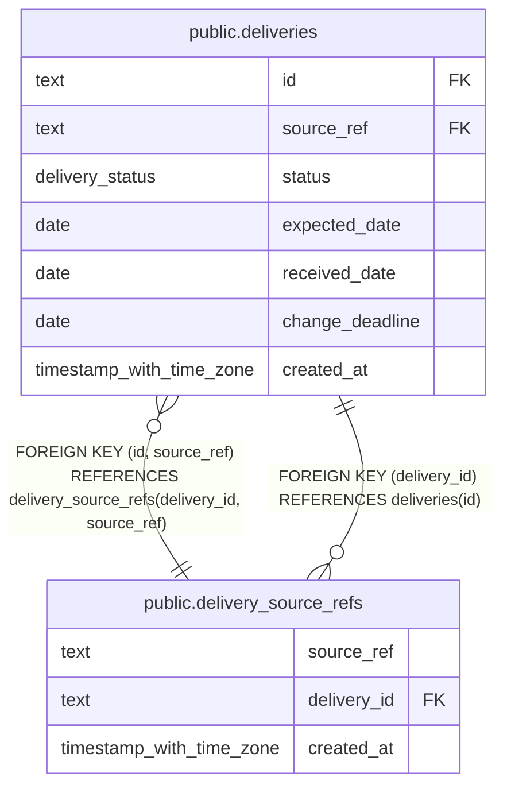

# public.delivery_source_refs

## Description

External references assigned to deliveries, including corrected references.

## Columns

| Name        | Type                     | Default | Nullable | Children                                  | Parents                                   | Comment                                                |
| ----------- | ------------------------ | ------- | -------- | ----------------------------------------- | ----------------------------------------- | ------------------------------------------------------ |
| source_ref  | text                     |         | false    | [public.deliveries](public.deliveries.md) |                                           | Unique external identifier used to resolve a delivery. |
| delivery_id | text                     |         | false    | [public.deliveries](public.deliveries.md) | [public.deliveries](public.deliveries.md) | Identifier of the delivery that used this reference.   |
| created_at  | timestamp with time zone | now()   | false    |                                           |                                           |                                                        |

## Constraints

| Name                                              | Type        | Definition                                          |
| ------------------------------------------------- | ----------- | --------------------------------------------------- |
| delivery_source_refs_created_at_not_null          | n           | NOT NULL created_at                                 |
| delivery_source_refs_delivery_id_not_null         | n           | NOT NULL delivery_id                                |
| delivery_source_refs_source_ref_nonblank          | CHECK       | CHECK ((btrim(source_ref) <> ''::text))             |
| delivery_source_refs_source_ref_not_null          | n           | NOT NULL source_ref                                 |
| delivery_source_refs_delivery_id_deliveries_id_fk | FOREIGN KEY | FOREIGN KEY (delivery_id) REFERENCES deliveries(id) |
| delivery_source_refs_pkey                         | PRIMARY KEY | PRIMARY KEY (source_ref)                            |

## Indexes

| Name                                            | Definition                                                                                                                               |
| ----------------------------------------------- | ---------------------------------------------------------------------------------------------------------------------------------------- |
| delivery_source_refs_pkey                       | CREATE UNIQUE INDEX delivery_source_refs_pkey ON public.delivery_source_refs USING btree (source_ref)                                    |
| delivery_source_refs_delivery_id_source_ref_key | CREATE UNIQUE INDEX delivery_source_refs_delivery_id_source_ref_key ON public.delivery_source_refs USING btree (delivery_id, source_ref) |

## Relations

---

> Generated by [tbls](https://github.com/k1LoW/tbls)
