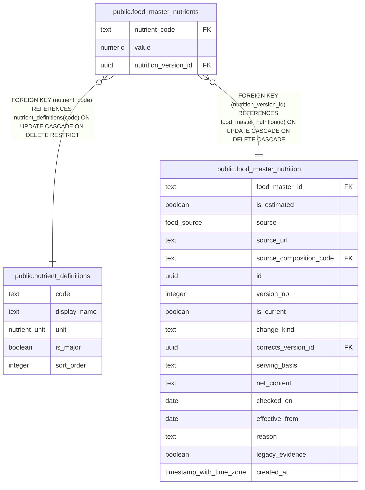

# public.food_master_nutrients

## Description

Nutrient values associated with nutrition versions.

## Columns

| Name                 | Type    | Default | Nullable | Children | Parents                                                         | Comment                                                             |
| -------------------- | ------- | ------- | -------- | -------- | --------------------------------------------------------------- | ------------------------------------------------------------------- |
| nutrient_code        | text    |         | false    |          | [public.nutrient_definitions](public.nutrient_definitions.md)   | Identifier of the nutrient.                                         |
| value                | numeric |         | false    |          |                                                                 | Nutrient value for the nutrition version.                           |
| nutrition_version_id | uuid    |         | false    |          | [public.food_master_nutrition](public.food_master_nutrition.md) | Identifier of the nutrition version this nutrient value belongs to. |

## Constraints

| Name                                                | Type        | Definition                                                                                                  |
| --------------------------------------------------- | ----------- | ----------------------------------------------------------------------------------------------------------- |
| food_master_nutrients_nutrient_code_not_null        | n           | NOT NULL nutrient_code                                                                                      |
| food_master_nutrients_nutrition_version_id_not_null | n           | NOT NULL nutrition_version_id                                                                               |
| food_master_nutrients_value_nonneg                  | CHECK       | CHECK ((value >= (0)::numeric))                                                                             |
| food_master_nutrients_value_not_null                | n           | NOT NULL value                                                                                              |
| food_master_nutrients_nutrient_code_fk              | FOREIGN KEY | FOREIGN KEY (nutrient_code) REFERENCES nutrient_definitions(code) ON UPDATE CASCADE ON DELETE RESTRICT      |
| food_master_nutrients_nutrition_version_id_fk       | FOREIGN KEY | FOREIGN KEY (nutrition_version_id) REFERENCES food_master_nutrition(id) ON UPDATE CASCADE ON DELETE CASCADE |
| food_master_nutrients_pkey                          | PRIMARY KEY | PRIMARY KEY (nutrition_version_id, nutrient_code)                                                           |

## Indexes

| Name                                    | Definition                                                                                                                       |
| --------------------------------------- | -------------------------------------------------------------------------------------------------------------------------------- |
| food_master_nutrients_nutrient_code_idx | CREATE INDEX food_master_nutrients_nutrient_code_idx ON public.food_master_nutrients USING btree (nutrient_code)                 |
| food_master_nutrients_pkey              | CREATE UNIQUE INDEX food_master_nutrients_pkey ON public.food_master_nutrients USING btree (nutrition_version_id, nutrient_code) |

## Relations

---

> Generated by [tbls](https://github.com/k1LoW/tbls)
