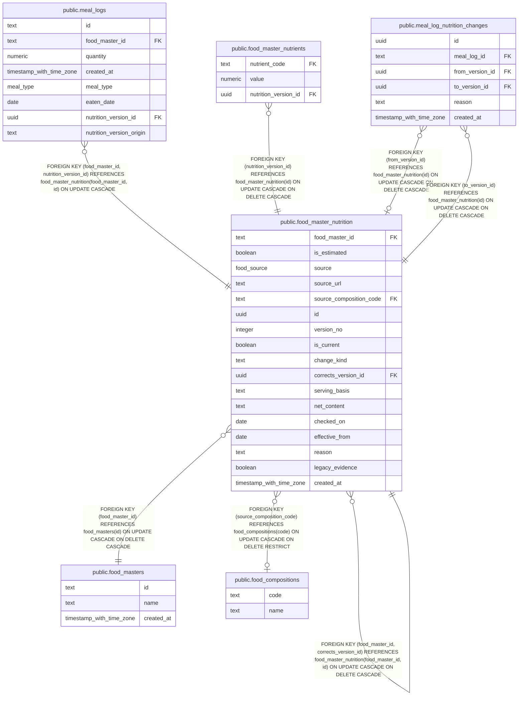

# public.food_master_nutrition

## Description

Versioned nutrition metadata for registered foods.

## Columns

| Name                    | Type                     | Default  | Nullable | Children                                                                                                                                                                                                                                          | Parents                                                                                                       | Comment                                                                                              |
| ----------------------- | ------------------------ | -------- | -------- | ------------------------------------------------------------------------------------------------------------------------------------------------------------------------------------------------------------------------------------------------- | ------------------------------------------------------------------------------------------------------------- | ---------------------------------------------------------------------------------------------------- |
| food_master_id          | text                     |          | false    | [public.meal_logs](public.meal_logs.md) [public.food_master_nutrition](public.food_master_nutrition.md)                                                                                                                                           | [public.food_masters](public.food_masters.md) [public.food_master_nutrition](public.food_master_nutrition.md) | Identifier of the food master this nutrition metadata belongs to.                                    |
| is_estimated            | boolean                  | false    | false    |                                                                                                                                                                                                                                                   |                                                                                                               | Whether the nutrition values are estimated.                                                          |
| source                  | food_source              |          | false    |                                                                                                                                                                                                                                                   |                                                                                                               | Origin of the nutrition values: web search, food composition table, user input, or a model estimate. |
| source_url              | text                     |          | true     |                                                                                                                                                                                                                                                   |                                                                                                               | URL of the web page used as evidence for the nutrition values.                                       |
| source_composition_code | text                     |          | true     |                                                                                                                                                                                                                                                   | [public.food_compositions](public.food_compositions.md)                                                       | Code of the food composition entry used as evidence.                                                 |
| id                      | uuid                     | uuidv7() | false    | [public.food_master_nutrients](public.food_master_nutrients.md) [public.meal_logs](public.meal_logs.md) [public.food_master_nutrition](public.food_master_nutrition.md) [public.meal_log_nutrition_changes](public.meal_log_nutrition_changes.md) |                                                                                                               | Identifier of the nutrition version.                                                                 |
| version_no              | integer                  |          | false    |                                                                                                                                                                                                                                                   |                                                                                                               | Sequential version number within the food master.                                                    |
| is_current              | boolean                  |          | false    |                                                                                                                                                                                                                                                   |                                                                                                               | Whether this is the current nutrition version.                                                       |
| change_kind             | text                     |          | false    |                                                                                                                                                                                                                                                   |                                                                                                               | Kind of change that created this nutrition version.                                                  |
| corrects_version_id     | uuid                     |          | true     |                                                                                                                                                                                                                                                   | [public.food_master_nutrition](public.food_master_nutrition.md)                                               | Identifier of the nutrition version corrected by this version, when applicable.                      |
| serving_basis           | text                     |          | true     |                                                                                                                                                                                                                                                   |                                                                                                               | Description of what one food unit represents.                                                        |
| net_content             | text                     |          | true     |                                                                                                                                                                                                                                                   |                                                                                                               | Net content represented by one food unit.                                                            |
| checked_on              | date                     |          | true     |                                                                                                                                                                                                                                                   |                                                                                                               | Date the nutrition information was checked.                                                          |
| effective_from          | date                     |          | true     |                                                                                                                                                                                                                                                   |                                                                                                               | Date the nutrition information became applicable.                                                    |
| reason                  | text                     |          | true     |                                                                                                                                                                                                                                                   |                                                                                                               | Reason for this nutrition change.                                                                    |
| legacy_evidence         | boolean                  | false    | false    |                                                                                                                                                                                                                                                   |                                                                                                               | Whether the source evidence predates current evidence requirements.                                  |
| created_at              | timestamp with time zone | now()    | false    |                                                                                                                                                                                                                                                   |                                                                                                               |                                                                                                      |

## Constraints

| Name                                             | Type        | Definition                                                                                                                                                                                |
| ------------------------------------------------ | ----------- | ----------------------------------------------------------------------------------------------------------------------------------------------------------------------------------------- |
| food_master_nutrition_change_kind_check          | CHECK       | CHECK ((change_kind = ANY (ARRAY['initial'::text, 'product_update'::text, 'correction'::text])))                                                                                          |
| food_master_nutrition_change_kind_not_null       | n           | NOT NULL change_kind                                                                                                                                                                      |
| food_master_nutrition_composition_evidence       | CHECK       | CHECK (((legacy_evidence = true) OR (source <> 'composition_table_estimate'::food_source) OR ((is_estimated = true) AND (source_url IS NULL) AND (source_composition_code IS NOT NULL)))) |
| food_master_nutrition_created_at_not_null        | n           | NOT NULL created_at                                                                                                                                                                       |
| food_master_nutrition_food_master_id_not_null    | n           | NOT NULL food_master_id                                                                                                                                                                   |
| food_master_nutrition_id_not_null                | n           | NOT NULL id                                                                                                                                                                               |
| food_master_nutrition_is_current_not_null        | n           | NOT NULL is_current                                                                                                                                                                       |
| food_master_nutrition_is_estimated_not_null      | n           | NOT NULL is_estimated                                                                                                                                                                     |
| food_master_nutrition_legacy_evidence_not_null   | n           | NOT NULL legacy_evidence                                                                                                                                                                  |
| food_master_nutrition_model_estimate_evidence    | CHECK       | CHECK (((legacy_evidence = true) OR ((source)::text <> 'model_estimate'::text) OR ((is_estimated = true) AND (source_url IS NULL) AND (source_composition_code IS NULL))))                |
| food_master_nutrition_source_not_null            | n           | NOT NULL source                                                                                                                                                                           |
| food_master_nutrition_user_input_evidence        | CHECK       | CHECK (((legacy_evidence = true) OR (source <> 'user_input'::food_source) OR ((source_url IS NULL) AND (source_composition_code IS NULL))))                                               |
| food_master_nutrition_version_no_not_null        | n           | NOT NULL version_no                                                                                                                                                                       |
| food_master_nutrition_version_no_positive        | CHECK       | CHECK ((version_no > 0))                                                                                                                                                                  |
| food_master_nutrition_web_search_evidence        | CHECK       | CHECK (((legacy_evidence = true) OR (source <> 'web_search'::food_source) OR ((is_estimated = false) AND (source_url IS NOT NULL) AND (source_composition_code IS NULL))))                |
| food_master_nutrition_source_composition_code_fk | FOREIGN KEY | FOREIGN KEY (source_composition_code) REFERENCES food_compositions(code) ON UPDATE CASCADE ON DELETE RESTRICT                                                                             |
| food_master_nutrition_food_master_id_fk          | FOREIGN KEY | FOREIGN KEY (food_master_id) REFERENCES food_masters(id) ON UPDATE CASCADE ON DELETE CASCADE                                                                                              |
| food_master_nutrition_pkey                       | PRIMARY KEY | PRIMARY KEY (id)                                                                                                                                                                          |
| food_master_nutrition_corrects_version_fk        | FOREIGN KEY | FOREIGN KEY (food_master_id, corrects_version_id) REFERENCES food_master_nutrition(food_master_id, id) ON UPDATE CASCADE ON DELETE CASCADE                                                |

## Indexes

| Name                                                | Definition                                                                                                                                                                           |
| --------------------------------------------------- | ------------------------------------------------------------------------------------------------------------------------------------------------------------------------------------ |
| food_master_nutrition_is_estimated_idx              | CREATE INDEX food_master_nutrition_is_estimated_idx ON public.food_master_nutrition USING btree (is_estimated) WHERE (is_estimated = true)                                           |
| food_master_nutrition_source_composition_code_idx   | CREATE INDEX food_master_nutrition_source_composition_code_idx ON public.food_master_nutrition USING btree (source_composition_code)                                                 |
| food_master_nutrition_pkey                          | CREATE UNIQUE INDEX food_master_nutrition_pkey ON public.food_master_nutrition USING btree (id)                                                                                      |
| food_master_nutrition_food_master_id_id_key         | CREATE UNIQUE INDEX food_master_nutrition_food_master_id_id_key ON public.food_master_nutrition USING btree (food_master_id, id)                                                     |
| food_master_nutrition_food_master_id_version_no_key | CREATE UNIQUE INDEX food_master_nutrition_food_master_id_version_no_key ON public.food_master_nutrition USING btree (food_master_id, version_no)                                     |
| food_master_nutrition_current_food_master_id_key    | CREATE UNIQUE INDEX food_master_nutrition_current_food_master_id_key ON public.food_master_nutrition USING btree (food_master_id) WHERE (is_current = true)                          |
| food_master_nutrition_corrects_version_id_idx       | CREATE INDEX food_master_nutrition_corrects_version_id_idx ON public.food_master_nutrition USING btree (food_master_id, corrects_version_id) WHERE (corrects_version_id IS NOT NULL) |

## Relations

---

> Generated by [tbls](https://github.com/k1LoW/tbls)
