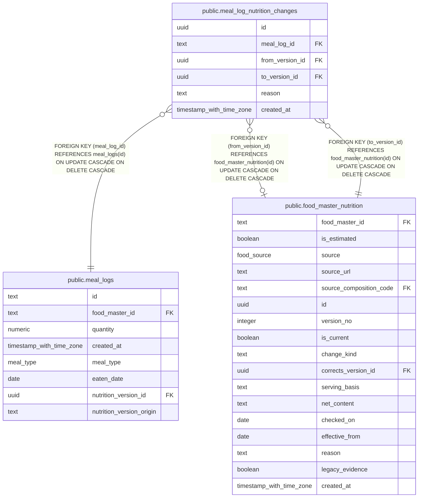

# public.meal_log_nutrition_changes

## Description

Nutrition version replacements recorded for meal logs.

## Columns

| Name            | Type                     | Default  | Nullable | Children | Parents                                                         | Comment                                                     |
| --------------- | ------------------------ | -------- | -------- | -------- | --------------------------------------------------------------- | ----------------------------------------------------------- |
| id              | uuid                     | uuidv7() | false    |          |                                                                 |                                                             |
| meal_log_id     | text                     |          | false    |          | [public.meal_logs](public.meal_logs.md)                         | Identifier of the meal log whose nutrition version changed. |
| from_version_id | uuid                     |          | true     |          | [public.food_master_nutrition](public.food_master_nutrition.md) | Identifier of the previous nutrition version, when known.   |
| to_version_id   | uuid                     |          | false    |          | [public.food_master_nutrition](public.food_master_nutrition.md) | Identifier of the replacement nutrition version.            |
| reason          | text                     |          | false    |          |                                                                 | Reason for replacing the nutrition version.                 |
| created_at      | timestamp with time zone | now()    | false    |          |                                                                 |                                                             |

## Constraints

| Name                                              | Type        | Definition                                                                                             |
| ------------------------------------------------- | ----------- | ------------------------------------------------------------------------------------------------------ |
| meal_log_nutrition_changes_created_at_not_null    | n           | NOT NULL created_at                                                                                    |
| meal_log_nutrition_changes_id_not_null            | n           | NOT NULL id                                                                                            |
| meal_log_nutrition_changes_meal_log_id_not_null   | n           | NOT NULL meal_log_id                                                                                   |
| meal_log_nutrition_changes_reason_not_null        | n           | NOT NULL reason                                                                                        |
| meal_log_nutrition_changes_to_version_id_not_null | n           | NOT NULL to_version_id                                                                                 |
| meal_log_nutrition_changes_meal_log_id_fk         | FOREIGN KEY | FOREIGN KEY (meal_log_id) REFERENCES meal_logs(id) ON UPDATE CASCADE ON DELETE CASCADE                 |
| meal_log_nutrition_changes_from_version_id_fk     | FOREIGN KEY | FOREIGN KEY (from_version_id) REFERENCES food_master_nutrition(id) ON UPDATE CASCADE ON DELETE CASCADE |
| meal_log_nutrition_changes_to_version_id_fk       | FOREIGN KEY | FOREIGN KEY (to_version_id) REFERENCES food_master_nutrition(id) ON UPDATE CASCADE ON DELETE CASCADE   |
| meal_log_nutrition_changes_pkey                   | PRIMARY KEY | PRIMARY KEY (id)                                                                                       |

## Indexes

| Name                                           | Definition                                                                                                                     |
| ---------------------------------------------- | ------------------------------------------------------------------------------------------------------------------------------ |
| meal_log_nutrition_changes_pkey                | CREATE UNIQUE INDEX meal_log_nutrition_changes_pkey ON public.meal_log_nutrition_changes USING btree (id)                      |
| meal_log_nutrition_changes_meal_log_id_idx     | CREATE INDEX meal_log_nutrition_changes_meal_log_id_idx ON public.meal_log_nutrition_changes USING btree (meal_log_id)         |
| meal_log_nutrition_changes_from_version_id_idx | CREATE INDEX meal_log_nutrition_changes_from_version_id_idx ON public.meal_log_nutrition_changes USING btree (from_version_id) |
| meal_log_nutrition_changes_to_version_id_idx   | CREATE INDEX meal_log_nutrition_changes_to_version_id_idx ON public.meal_log_nutrition_changes USING btree (to_version_id)     |

## Relations

---

> Generated by [tbls](https://github.com/k1LoW/tbls)
