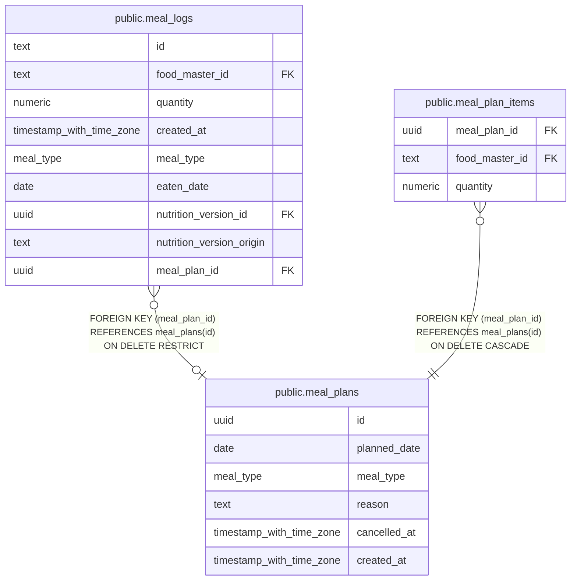

# public.meal_plans

## Description

Dated meal plans kept separate from recorded consumption.

## Columns

| Name         | Type                     | Default  | Nullable | Children                                                                                    | Parents | Comment                                            |
| ------------ | ------------------------ | -------- | -------- | ------------------------------------------------------------------------------------------- | ------- | -------------------------------------------------- |
| id           | uuid                     | uuidv7() | false    | [public.meal_logs](public.meal_logs.md) [public.meal_plan_items](public.meal_plan_items.md) |         |                                                    |
| planned_date | date                     |          | false    |                                                                                             |         | Asia/Tokyo calendar date planned for the meal.     |
| meal_type    | meal_type                |          | false    |                                                                                             |         | Meal category planned for the date.                |
| reason       | text                     |          | true     |                                                                                             |         | Reason for choosing the planned foods.             |
| cancelled_at | timestamp with time zone |          | true     |                                                                                             |         | Time when the plan was cancelled, when applicable. |
| created_at   | timestamp with time zone | now()    | false    |                                                                                             |         |                                                    |

## Constraints

| Name                             | Type        | Definition                                                |
| -------------------------------- | ----------- | --------------------------------------------------------- |
| meal_plans_created_at_not_null   | n           | NOT NULL created_at                                       |
| meal_plans_id_not_null           | n           | NOT NULL id                                               |
| meal_plans_meal_type_not_null    | n           | NOT NULL meal_type                                        |
| meal_plans_planned_date_not_null | n           | NOT NULL planned_date                                     |
| meal_plans_reason_nonblank       | CHECK       | CHECK (((reason IS NULL) OR (btrim(reason) <> ''::text))) |
| meal_plans_pkey                  | PRIMARY KEY | PRIMARY KEY (id)                                          |

## Indexes

| Name                        | Definition                                                                                                                             |
| --------------------------- | -------------------------------------------------------------------------------------------------------------------------------------- |
| meal_plans_pkey             | CREATE UNIQUE INDEX meal_plans_pkey ON public.meal_plans USING btree (id)                                                              |
| meal_plans_active_slot_key  | CREATE UNIQUE INDEX meal_plans_active_slot_key ON public.meal_plans USING btree (planned_date, meal_type) WHERE (cancelled_at IS NULL) |
| meal_plans_planned_date_idx | CREATE INDEX meal_plans_planned_date_idx ON public.meal_plans USING btree (planned_date)                                               |

## Relations

---

> Generated by [tbls](https://github.com/k1LoW/tbls)
