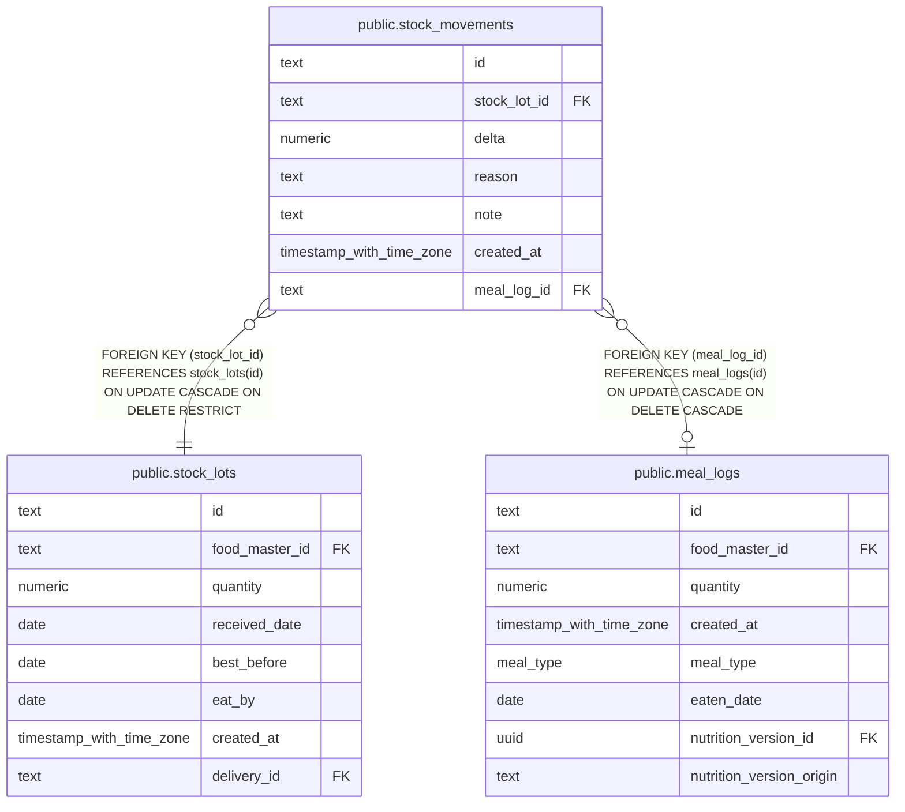

# public.stock_movements

## Description

Quantity changes recorded against stock lots.

## Columns

| Name         | Type                     | Default | Nullable | Children | Parents                                   | Comment                                                  |
| ------------ | ------------------------ | ------- | -------- | -------- | ----------------------------------------- | -------------------------------------------------------- |
| id           | text                     |         | false    |          |                                           |                                                          |
| stock_lot_id | text                     |         | false    |          | [public.stock_lots](public.stock_lots.md) | Identifier of the stock batch affected by this movement. |
| delta        | numeric                  |         | false    |          |                                           | Signed quantity change in food units.                    |
| reason       | text                     |         | false    |          |                                           | Reason for the quantity change: receive, meal, or count. |
| note         | text                     |         | true     |          |                                           | Optional note explaining the quantity change.            |
| created_at   | timestamp with time zone | now()   | false    |          |                                           |                                                          |
| meal_log_id  | text                     |         | true     |          | [public.meal_logs](public.meal_logs.md)   | Identifier of the meal log that caused this movement.    |

## Constraints

| Name                                  | Type        | Definition                                                                                |
| ------------------------------------- | ----------- | ----------------------------------------------------------------------------------------- |
| stock_movements_created_at_not_null   | n           | NOT NULL created_at                                                                       |
| stock_movements_delta_nonzero         | CHECK       | CHECK ((delta <> (0)::numeric))                                                           |
| stock_movements_delta_not_null        | n           | NOT NULL delta                                                                            |
| stock_movements_id_not_null           | n           | NOT NULL id                                                                               |
| stock_movements_meal_log_reason       | CHECK       | CHECK (((reason = 'meal'::text) = (meal_log_id IS NOT NULL)))                             |
| stock_movements_reason_not_null       | n           | NOT NULL reason                                                                           |
| stock_movements_reason_valid          | CHECK       | CHECK ((reason = ANY (ARRAY['receive'::text, 'meal'::text, 'count'::text])))              |
| stock_movements_stock_lot_id_not_null | n           | NOT NULL stock_lot_id                                                                     |
| stock_movements_meal_log_id_fk        | FOREIGN KEY | FOREIGN KEY (meal_log_id) REFERENCES meal_logs(id) ON UPDATE CASCADE ON DELETE CASCADE    |
| stock_movements_stock_lot_id_fk       | FOREIGN KEY | FOREIGN KEY (stock_lot_id) REFERENCES stock_lots(id) ON UPDATE CASCADE ON DELETE RESTRICT |
| stock_movements_pkey                  | PRIMARY KEY | PRIMARY KEY (id)                                                                          |

## Indexes

| Name                             | Definition                                                                                         |
| -------------------------------- | -------------------------------------------------------------------------------------------------- |
| stock_movements_pkey             | CREATE UNIQUE INDEX stock_movements_pkey ON public.stock_movements USING btree (id)                |
| stock_movements_stock_lot_id_idx | CREATE INDEX stock_movements_stock_lot_id_idx ON public.stock_movements USING btree (stock_lot_id) |
| stock_movements_meal_log_id_idx  | CREATE INDEX stock_movements_meal_log_id_idx ON public.stock_movements USING btree (meal_log_id)   |

## Relations

---

> Generated by [tbls](https://github.com/k1LoW/tbls)
